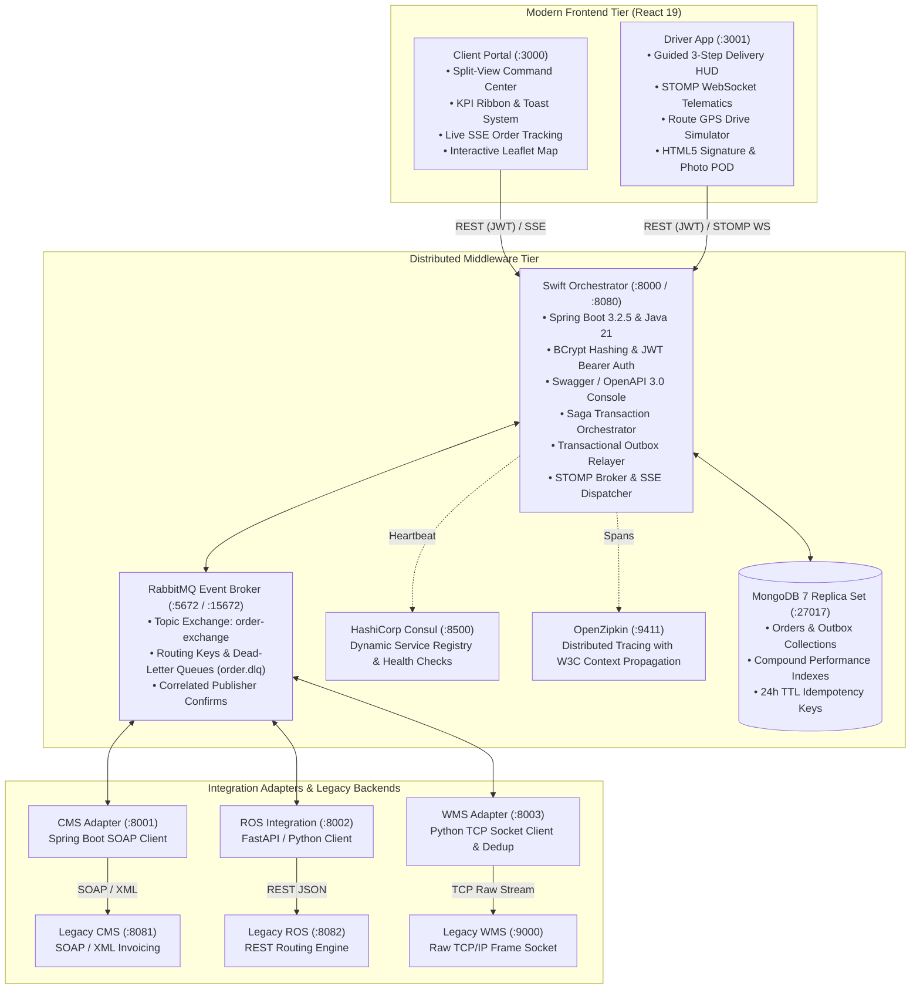

# SwiftLogistics — Enterprise Distributed Logistics Middleware Platform

[](https://github.com/sakiththewmika/swift-logistics/actions/workflows/ci.yml)


An enterprise-grade, event-driven polyglot distributed middleware platform bridging modern real-time SaaS frontends with heterogeneous legacy enterprise systems (**SOAP/XML**, **TCP/IP Socket Streams**, and **RESTful microservices**).

Built to demonstrate resilient architectural design patterns under real-world logistics conditions: **Transactional Outbox**, **Saga Orchestration with Compensation**, **Resilience4j Circuit Breakers**, **Consul Service Discovery**, **OpenTelemetry Distributed Tracing**, **Consumer Idempotency**, and **Bi-Directional STOMP/SSE Telematics**.

---

## 🏛️ System Architecture



---

## 🎯 7 Enterprise Architectural Patterns

| # | Enterprise Pattern | Implementation Details in SwiftLogistics |
|---|-------------------|------------------------------------------|
| **1** | **Transactional Outbox** | Writes order state mutations and outbox records atomically within a single MongoDB multi-document transaction (`@Transactional`). A scheduled relayer daemon asynchronously publishes events to RabbitMQ with publisher confirms, eliminating distributed dual-write inconsistency. |
| **2** | **Saga Orchestration & Compensation** | Centralized Saga orchestrator managing forward progression (`CREATED` $\rightarrow$ `BILLED` $\rightarrow$ `PACKED` $\rightarrow$ `ROUTED` $\rightarrow$ `IN_TRANSIT` $\rightarrow$ `DELIVERED`). On downstream service timeout or failure, the Saga automatically emits compensating rollback commands (`BILLING_COMPENSATION_REQUESTED`, `ORDER_CANCELLED_REFUNDED`). |
| **3** | **Resilience4j Circuit Breaker & Fallback** | Wraps fragile legacy SOAP and TCP calls with configurable thresholds (`failureRateThreshold=50%`, `slidingWindowSize=10`, `waitDurationInOpenState=10s`). Trips open under legacy downtime and serves graceful fallbacks to maintain system availability. |
| **4** | **Consul Service Discovery & Heartbeats** | Microservices dynamically register with HashiCorp Consul on boot. Actuator `/actuator/health` heartbeats run every 10s. Downstream clients resolve service instances dynamically without hardcoded IPs. |
| **5** | **Distributed Tracing (OpenTelemetry / Zipkin)** | Injects and extracts W3C `traceparent` headers across HTTP requests, AMQP message headers, and raw socket protocols. Complete end-to-end trace waterfalls are inspectable in the OpenZipkin UI. |
| **6** | **Consumer Idempotency & De-Duplication** | Protects endpoints via `Idempotency-Key` headers stored in MongoDB with 24-hour TTL expiration. Downstream adapter consumers maintain an SQLite WAL dedup cache, discarding redundant AMQP deliveries. |
| **7** | **STOMP WebSockets & SSE Telematics** | Bidirectional courier GPS coordinate ingestion over STOMP WebSocket (`/ws/driver`) paired with unidirectional Server-Sent Events (`/sse/order/{orderId}`) streaming live telematics directly to the Client Portal's Leaflet maps with zero page reload. |

---

## 🔐 Security & OpenAPI Specifications

- **BCrypt Password Hashing**: Passwords stored as salted BCrypt hashes (`$2a$10$...`) with transparent runtime migration for legacy records.
- **Stateless JWT Bearer Authentication**: HMAC-SHA256 tokens issued with 24-hour validity, encoding `sub` (User ID), `email`, and `role` (`CUSTOMER`, `DRIVER`).
- **Interactive OpenAPI 3.0 / Swagger UI**: Direct API exploration and JWT-authorized endpoint execution available at [`http://localhost:8080/swagger-ui.html`](http://localhost:8080/swagger-ui.html).
- **Compound & TTL Database Indexes**:
  - `outbox_status_created_idx` on `outbox_events` (`{'status': 1, 'createdAt': 1}`) for rapid publisher polling.
  - `order_customer_created_idx` on `orders` (`{'customerId': 1, 'createdAt': -1}`) for fast dashboard listing.
  - 86,400s (24h) TTL expiration on `idempotency_keys` and `processed_messages`.

---

## 🚀 Quick Start (Docker Compose)

### Prerequisites
- **Docker Engine** (24.0+) & **Docker Compose v2**
- Host ports available: `3000`, `3001`, `8000`, `8080`, `8500`, `9411`, `15672`, `27017`

### 1. Launch the Complete Ecosystem
```bash
# Clone the repository
git clone https://github.com/sakiththewmika/swift-logistics.git
cd swift-logistics

# Start all containers in detached mode
cd infra
docker compose up --build -d
```

### 2. Verify Container Health
```bash
docker compose ps
```
Wait ~30 seconds for MongoDB replica set initialization and Consul service registrations to report healthy.

---

## 🔑 Demo Accounts & Port Reference

### Ready-to-Use Demo Credentials
| Role | Portal URL | Username / Email | Password |
|------|------------|------------------|----------|
| **Client / Customer** | [http://localhost:3000](http://localhost:3000) | `john@example.com` | `password123` |
| **Courier / Driver** | [http://localhost:3001](http://localhost:3001) | `driver1@swiftlogistics.com` | `password123` |
| **RabbitMQ Admin** | [http://localhost:15672](http://localhost:15672) | `guest` | `guest` |

### Infrastructure & Service Ports
| Service | Technology | Port | Purpose / Dashboard |
|---------|------------|------|---------------------|
| **Client Portal** | React 19 / Leaflet | **3000** | Customer dashboard, KPI ribbon & live order tracking |
| **Driver App** | React 19 / STOMP | **3001** | Courier HUD, GPS telematics simulator & POD capture |
| **Swift Orchestrator** | Spring Boot 3.2.5 | **8000 / 8080** | Core API, Saga orchestrator, WebSocket & Outbox |
| **Swagger UI** | SpringDoc OpenAPI 3 | **8080** | [`http://localhost:8080/swagger-ui.html`](http://localhost:8080/swagger-ui.html) |
| **HashiCorp Consul** | Go / Consul UI | **8500** | Service discovery catalog & health monitoring |
| **OpenZipkin** | Zipkin UI | **9411** | Distributed trace waterfall visualization |
| **RabbitMQ Management**| Erlang / AMQP | **15672** | Broker queues, bindings, exchanges & DLQ inspection |
| **MongoDB** | MongoDB 7 Replica Set| **27017** | Document datastore with replica set transactions |
| **CMS Adapter** | Spring Boot / JAXB | **8001** | SOAP $\leftrightarrow$ AMQP mediation |
| **ROS Integration** | FastAPI / Python | **8002** | REST $\leftrightarrow$ AMQP route optimization adapter |
| **WMS Adapter** | Python Asyncio | **8003** | TCP socket $\leftrightarrow$ AMQP warehouse adapter |
| **Legacy CMS** | Spring Boot SOAP | **8081** | Simulated legacy billing engine |
| **Legacy ROS** | Python REST | **8082** | Simulated legacy route solver |
| **Legacy WMS** | Python TCP Server | **9000** | Simulated legacy warehouse TCP socket |

---

## 🧪 Interactive Architecture Demonstration

1. **Launch the Client Portal** at [`http://localhost:3000`](http://localhost:3000) and sign in.
2. Click **"Middleware Ops & Chaos Console"** in the top navigation bar to test live distributed patterns:
   - **1-Click Happy Path**: Creates an Express order and streams live state updates (`CREATED` $\rightarrow$ `BILLED` $\rightarrow$ `PACKED` $\rightarrow$ `ROUTED` $\rightarrow$ `DISPATCHED`).
   - **Concurrent Idempotency Attack**: Dispatches twin requests with matching `Idempotency-Key` headers to prove exactly-once database persistence.
   - **DLQ Message Replay**: Re-queues dead-lettered messages from `order.dlq` directly back into the live exchange.
3. **Open the Driver App** at [`http://localhost:3001`](http://localhost:3001):
   - Click **"1. Start Delivery Trip (Mark In-Transit)"** to activate the live GPS drive simulator.
   - Watch the delivery truck move in real time across the Leaflet map on **both** the Driver App and the Client Portal simultaneously via STOMP WebSocket & SSE!
   - Capture an HTML5 touchscreen signature & parcel photo in **"2. Complete Delivery"** to finalize the order.
4. **Inspect Distributed Traces**:
   - Open OpenZipkin at [`http://localhost:9411`](http://localhost:9411) and click **"Run Query"** to view cross-service spans traversing Spring Boot, RabbitMQ AMQP, and legacy adapters.

---

## 🛠️ Local Development & Testing

### Backend Unit & Integration Tests (Java 21)
```bash
# Orchestrator compilation & tests
mvn clean test --file services/orchestrator/pom.xml

# CMS Adapter
mvn clean test-compile --file services/cms-adapter/pom.xml
```

### Python Services Lint & Syntax Checks (Python 3.11)
```bash
python -m compileall services/wms-adapter services/ros-integration
python -m unittest discover -s services/wms-adapter/test -p "test_*.py"
```

### Frontend Production Builds (Node 20 / React 19)
```bash
npm --prefix ui/client-portal run build
npm --prefix ui/driver-app run build
```

### Clean Teardown
```bash
cd infra
docker compose down -v
```

---

## 📄 License
This project is licensed under the Apache 2.0 License - see the [LICENSE](LICENSE) file for details.
