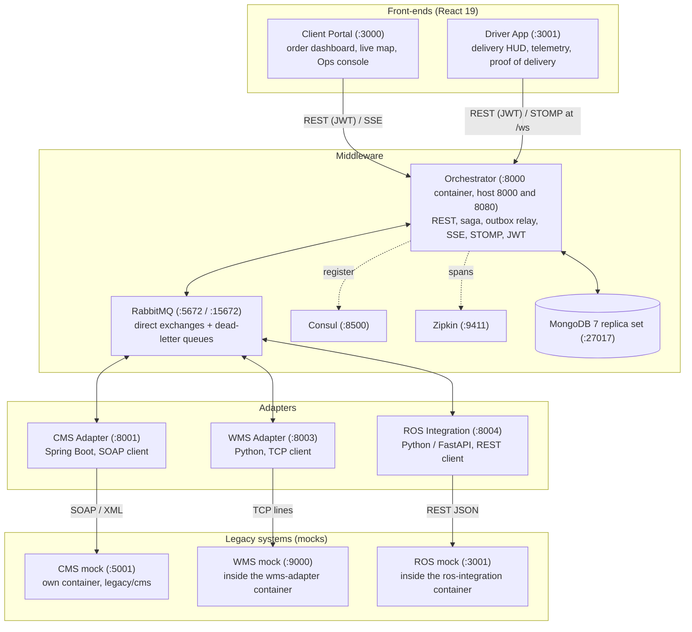

# SwiftLogistics — Distributed Logistics Middleware Platform

[](https://github.com/sakiththewmika/swift-logistics/actions/workflows/ci.yml)


An event-driven middleware that connects two modern web front-ends with three legacy back-office
systems that each speak a different protocol: **SOAP/XML** (billing), **raw TCP** (warehouse) and
**REST** (route optimisation). The legacy systems are mocks bundled with the project.

It demonstrates the **transactional outbox**, a **saga with compensation**, **circuit breakers**,
**consumer idempotency**, **service discovery**, **distributed tracing** and **real-time telematics**.

For the full design see [docs/architecture.md](docs/architecture.md); for running and operating the
stack see [infra/README.md](infra/README.md).

---

## System architecture



## Order lifecycle

`NEW → BILLED → (PROCESSING) → READY → (ROUTING) → ROUTED → IN_TRANSIT → DELIVERED`

Failure paths:

- billing fails → `BILLING_FAILED`
- warehouse fails → `WAREHOUSE_FAILED → COMPENSATING_BILLING → CANCELLED_REFUNDED`
- routing fails → `ROUTE_FAILED → COMPENSATING_WAREHOUSE → COMPENSATING_BILLING → CANCELLED_REFUNDED`
- delivery fails → `FAILED`

A state machine rejects any other change, so late or duplicated messages cannot move an order backwards.

## Enterprise patterns

| # | Pattern | Implementation |
|---|---|---|
| 1 | **Transactional outbox** | The order and its outgoing command are saved in one MongoDB transaction; a relay publishes pending rows to RabbitMQ with publisher confirms, so a crash can never lose or invent a message. |
| 2 | **Saga with compensation** | The orchestrator advances an order from each adapter's reply and, on failure, issues compensating commands (release the warehouse package, refund billing). Route-failure compensation is committed atomically with the failure itself. |
| 3 | **Circuit breakers and retries** | CMS adapter: Resilience4j (window 10, ≥ 5 calls, 50 % failures, **30 s** open) plus 4 retries and a recover step that fails billing instead of leaving an order in `NEW`. ROS adapter: its own breaker (5 failures, 30 s open) that pauses consumption. WMS adapter: retries, reconnect and back-off (the TCP leg has no breaker). |
| 4 | **Service discovery** | Services register with Consul; the WMS and ROS adapters discover their mock back-ends through it and fall back to configured addresses. The CMS adapter uses a fixed address. |
| 5 | **Distributed tracing** | `X-Correlation-Id` and W3C `traceparent` travel over HTTP and AMQP headers and spans go to Zipkin. The TCP warehouse leg cannot carry headers, so the adapter keeps the context and emits that span itself. |
| 6 | **Idempotency** | `POST /orders` requires an `Idempotency-Key` (24 h TTL). Consumers deduplicate in MongoDB (orchestrator, CMS adapter) or SQLite (WMS, ROS); a row stuck in `PROCESSING` after a crash is reclaimed after 60 s. |
| 7 | **Real-time channels** | Server-Sent Events at `/sse/order/{orderId}` for customers and STOMP over WebSocket at **`/ws`** for the driver app's telemetry and dispatch. |
| 8 | **Dead-letter recovery** | Every queue has a `<queue>.dlq` (via `<exchange>.dlx`); `POST /api/v1/recovery/replay` re-queues messages. |

## Security

- **BCrypt** password hashes (legacy plain-text values are upgraded at first login).
- **JWT bearer tokens** (HMAC-SHA256, 24 h) carrying `sub`, `email` and `role` (`CUSTOMER` / `DRIVER`).
- **Enforced by default** (`REQUIRE_JWT=true`) on orders, drivers and recovery routes, with per-resource
  ownership checks: customers see only their own orders, drivers only their assigned ones.
- `/sse/**` and `/ws/**` are intentionally open because browsers cannot add an `Authorization` header to
  `EventSource` or WebSocket handshakes.
- Sign-up accepts only whitelisted fields, so it can never overwrite another account; request bodies are validated.
- Errors are JSON (`{"message": "..."}`).
- Set `JWT_SECRET` in any deployment beyond a local demo.
- **Swagger UI:** [http://localhost:8080/swagger-ui.html](http://localhost:8080/swagger-ui.html).

## Quick start (Docker Compose)

Prerequisites: Docker Engine 24+ with Compose v2, and these free host ports:
`3000`, `3001`, `5001`, `5672`, `8000`, `8001`, `8003`, `8004`, `8080`, `8500`, `9411`, `15672`, `27017`.

```bash
git clone https://github.com/sakiththewmika/swift-logistics.git
cd swift-logistics/infra
docker compose up --build -d
docker compose ps          # wait until the services report (healthy)
```

The first build downloads Maven and npm dependencies and takes several minutes. Reset to a clean demo
database at any time with `docker compose down -v`.

## Demo accounts and ports

| Role | URL | Username / email | Password |
|---|---|---|---|
| Customer | [http://localhost:3000](http://localhost:3000) | `client@swift.lk` or `merchant@swift.lk` | `password123` |
| Driver | [http://localhost:3001](http://localhost:3001) | `driver1@swift.lk` or `driver2@swift.lk` | `password123` |
| RabbitMQ admin | [http://localhost:15672](http://localhost:15672) | `guest` | `guest` |

| Service | Technology | Port | Purpose |
|---|---|---|---|
| Client Portal | React 19, Leaflet | 3000 | Customer dashboard, KPIs, live tracking |
| Driver App | React 19, STOMP | 3001 | Courier HUD, GPS simulator, proof of delivery |
| Orchestrator | Spring Boot 3.2 | 8000 and 8080 (both map to container port 8000) | API, saga, outbox, SSE, STOMP |
| CMS Adapter | Spring Boot 3.5 | 8001 | AMQP ⇄ SOAP |
| WMS Adapter | Python, threads + pika | 8003 | AMQP ⇄ TCP |
| ROS Integration | Python, FastAPI | 8004 | AMQP ⇄ REST |
| CMS mock (`cms`) | Spring-WS | 5001 | Legacy billing SOAP service |
| Consul | HashiCorp | 8500 | Service catalog |
| Zipkin | OpenZipkin | 9411 | Trace UI |
| RabbitMQ | 3.12 | 5672 / 15672 | Broker / management UI |
| MongoDB | 7, replica set `rs0` | 27017 (localhost only) | Datastore |

## Interactive demo

1. Open the **Client Portal** and sign in (the *Fill Demo Customer* button helps).
2. Click **Middleware Ops & Chaos** to open the console (it signs in as the demo customer if nobody is):
   - **Scenario A — Launch Happy Path:** creates an express order and walks it through the saga.
   - **Scenario B — Test Duplicate Guard:** sends two concurrent requests with the same idempotency key
     and shows that only one order is created.
   - **Scenario C — Run Rollback Test:** the address contains `[FAIL_ROUTE]`, so route planning fails and the
     saga releases the warehouse package and refunds billing, ending in `CANCELLED_REFUNDED`.
   - **Dead-Letter Queue (DLQ) Replay:** re-queues messages from a chosen `<queue>.dlq`.
3. Open the **Driver App**, sign in as `driver1@swift.lk`:
   - **1. Start Delivery Trip (Mark In-Transit & Launch GPS)** starts the GPS simulator; the truck moves on
     both the Driver App and the Client Portal map.
   - **2. Complete Delivery (Capture Signature & Photo)** opens the proof-of-delivery form; a signature is required.
4. Open **Zipkin** at [http://localhost:9411](http://localhost:9411) and run a query to see the cross-service traces.

The `[FAIL_ROUTE]` trigger is controlled by `ENABLE_CHAOS_HOOKS` on the ROS adapter (default `true`);
set it to `false` to disable demo failure injection.

## Development and testing

Everything can run in containers, which avoids installing Java, Python or Node locally:

```bash
# Java suites (JDK 21)
docker run --rm -v "$PWD/services/orchestrator":/app -w /app maven:3.9.9-eclipse-temurin-21 mvn -B test
docker run --rm -v "$PWD/services/cms-adapter":/app -w /app maven:3.9.9-eclipse-temurin-21 mvn -B test
docker run --rm -v "$PWD/legacy/cms":/app -w /app maven:3.9.9-eclipse-temurin-21 mvn -B test

# Python suites (3.11)
docker run --rm -e DEDUP_DB_PATH=:memory: -e PYTHONDONTWRITEBYTECODE=1 -v "$PWD":/repo:ro -w /repo python:3.11-slim sh -c '
  python -m unittest discover -s services/wms-adapter/test -p "test_*.py" &&
  python -m unittest discover -s services/ros-integration/test -p "test_*.py"'

# Front-ends (the build treats lint warnings as errors when CI=true)
docker run --rm -v "$PWD/ui/client-portal":/app -w /app -e CI=true node:20-slim sh -c 'npm ci && npm run build && npm test -- --watchAll=false'
docker run --rm -v "$PWD/ui/driver-app":/app -w /app -e CI=true node:20-slim sh -c 'npm ci && npm run build && npm test -- --watchAll=false'
```

With a local toolchain, run `./mvnw test` in each Java project, `python -m unittest discover -s <service>/test`
for the Python services, and `npm test` / `npm run build` in each UI.

The Spring context tests run under a hermetic `test` profile (no database, broker or registry), so the
suites are safe to run anywhere. The same suites run in CI (`.github/workflows/ci.yml`).

## Repository layout

| Path | Contents |
|---|---|
| `services/orchestrator` | Core API and saga ([README](services/orchestrator/README.md)) |
| `services/cms-adapter` | SOAP adapter ([README](services/cms-adapter/README.md)) |
| `services/wms-adapter` | TCP adapter and WMS mock ([README](services/wms-adapter/README.md)) |
| `services/ros-integration` | REST adapter and ROS mock ([README](services/ros-integration/README.md)) |
| `legacy/cms` | Mock legacy billing SOAP service ([README](legacy/cms/README.md)) |
| `ui/client-portal`, `ui/driver-app` | React front-ends ([client](ui/client-portal/README.md), [driver](ui/driver-app/README.md)) |
| `infra` | Docker Compose stack ([README](infra/README.md)) |
| `docs` | [Architecture](docs/architecture.md) |

## License

Licensed under the Apache License, Version 2.0 — see [LICENSE](LICENSE).
