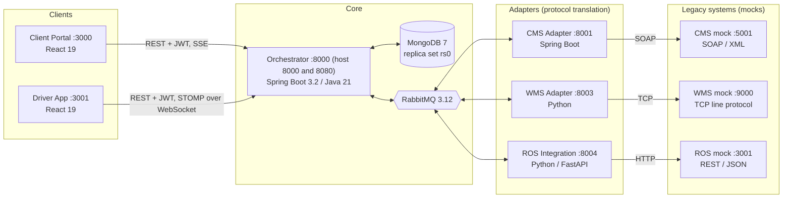
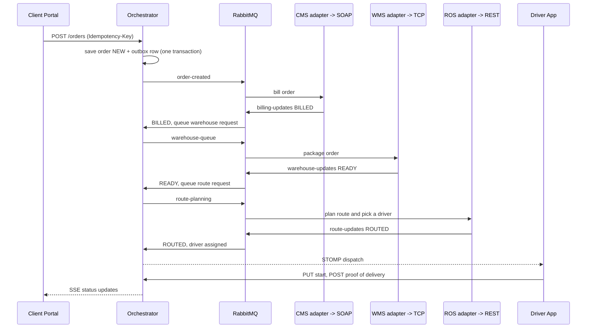

# SwiftLogistics — Middleware Architecture

This document describes the system as implemented in this repository. Where something is a demo
stand-in rather than a production component, it says so.

## Contents

1. [System overview](#1-system-overview)
2. [Components](#2-components)
3. [Order lifecycle](#3-order-lifecycle)
4. [Messaging topology](#4-messaging-topology)
5. [Reliability patterns](#5-reliability-patterns)
6. [Real-time channels](#6-real-time-channels)
7. [Security](#7-security)
8. [Data model](#8-data-model)
9. [REST API](#9-rest-api)
10. [Observability and discovery](#10-observability-and-discovery)
11. [Deployment](#11-deployment)
12. [Configuration](#12-configuration)
13. [Testing and CI](#13-testing-and-ci)
14. [Known limitations](#14-known-limitations)

---

## 1. System overview

SwiftLogistics integrates modern web clients with three heterogeneous back-office systems, each
speaking a different protocol, through an event-driven orchestrator.

The orchestrator never calls a legacy system directly. It writes commands to a transactional outbox;
a relay publishes them to RabbitMQ; adapters translate them to SOAP, TCP or REST and publish the
results back. The orchestrator advances (or compensates) the order from those results.

The WMS and ROS mocks run inside their adapter containers (`wms-adapter`, `ros-integration`); the CMS
mock is its own container (`cms`, from `legacy/cms`).

## 2. Components

| Component | Tech | Port(s) | Responsibility | Health |
|---|---|---|---|---|
| `services/orchestrator` | Spring Boot 3.2.5, Java 21 | 8000 (host 8000 and 8080) | REST API, saga orchestration, outbox relay, SSE and STOMP, JWT security | `GET /api/v1/orders/health` |
| `services/cms-adapter` | Spring Boot 3.5, Java 21 | 8001 | AMQP ⇄ SOAP for billing and refunds; Resilience4j circuit breaker | `GET /health` |
| `services/wms-adapter` | Python 3.11, pika, FastAPI | 8003 (mock TCP server on 9000, in-container) | AMQP ⇄ TCP for packaging and release | `GET /health` |
| `services/ros-integration` | Python 3.11, pika, FastAPI | 8004 (mock REST on 3001, in-container) | AMQP ⇄ REST for route planning and driver selection | `GET /health` |
| `legacy/cms` | Spring Boot, Spring-WS | 5001 | Mock legacy billing SOAP service | TCP port check |
| `ui/client-portal` | React 19, Leaflet | 3000 | Customer dashboard, live tracking, Ops console | — |
| `ui/driver-app` | React 19, STOMP.js, Leaflet | 3001 | Courier HUD, telemetry, proof of delivery | — |
| Infrastructure | MongoDB 7, RabbitMQ 3.12, Consul 1.18, Zipkin | 27017, 5672/15672, 8500, 9411 | Storage, messaging, discovery, tracing | healthchecks in compose |

## 3. Order lifecycle

### 3.1 Happy path

### 3.2 Order status state machine

All status changes go through `OrderStateMachine`; any other change is logged and ignored, so late,
duplicated or out-of-order messages cannot move an order backwards.

| From | Allowed next statuses |
|---|---|
| `NEW` | `BILLING_PENDING`, `BILLED`, `BILLING_FAILED` |
| `BILLING_PENDING` | `BILLED`, `BILLING_FAILED` |
| `BILLED` | `PROCESSING`, `READY`, `WAREHOUSE_FAILED` |
| `PROCESSING` | `READY`, `WAREHOUSE_FAILED` |
| `READY` | `ROUTING`, `ROUTED`, `ROUTE_FAILED` |
| `ROUTING` | `ROUTED`, `ROUTE_FAILED` |
| `ROUTED` | `ASSIGNED`, `IN_TRANSIT`, `DELIVERED`, `FAILED` |
| `ASSIGNED` | `IN_TRANSIT`, `DELIVERED`, `FAILED` |
| `IN_TRANSIT` | `DELIVERED`, `FAILED` |
| `WAREHOUSE_FAILED` | `COMPENSATING_BILLING` |
| `ROUTE_FAILED` | `COMPENSATING_WAREHOUSE` |
| `COMPENSATING_WAREHOUSE` | `COMPENSATING_BILLING` |
| `COMPENSATING_BILLING` | `CANCELLED_REFUNDED` |
| `BILLING_FAILED`, `DELIVERED`, `FAILED`, `CANCELLED`, `CANCELLED_REFUNDED` | none (terminal) |

`ASSIGNED` and `CANCELLED` exist in the enum but nothing currently sets them; routing moves an order
straight to `ROUTED` with its driver attached.

### 3.3 Compensation (saga rollback)

| Failure | What happens |
|---|---|
| CMS unreachable after retries, or SOAP fault | The CMS adapter publishes `FAILED`; the order becomes `BILLING_FAILED` (terminal; nothing to refund). |
| WMS reports `FAILED`, or packaging retries are exhausted | `WAREHOUSE_FAILED` → `COMPENSATING_BILLING`; the orchestrator asks the CMS to refund → `CANCELLED_REFUNDED`. |
| ROS reports `FAILED` | In one transaction: `ROUTE_FAILED`, the event is logged, `COMPENSATING_WAREHOUSE`, and a package-release command is queued. The WMS acknowledges → `COMPENSATING_BILLING` → refund → `CANCELLED_REFUNDED`. |
| Delivery fails (driver reports `FAILED`) | Terminal `FAILED`; no automatic refund. |

The demo trigger for the route-failure path is a delivery address containing `[FAIL_ROUTE]` (see
`ENABLE_CHAOS_HOOKS`).

### 3.4 Driver lifecycle

Routing reserves the chosen driver (`isAvailable = false`, status `ASSIGNED`); starting a delivery
sets `BUSY`; finishing the driver's last active order sets `AVAILABLE` again. Starting, completing or
submitting proof for an order in the wrong state returns `409`.

## 4. Messaging topology

All exchanges are durable **direct** exchanges. Every main queue dead-letters to
`<exchange>.dlx` with routing key `<queue>.dlq`, and a durable `<queue>.dlq` queue is bound there.

| Queue | Exchange | Routing key | Producer → Consumer |
|---|---|---|---|
| `order-created` | `order-created.exchange` | `order.created` | Orchestrator outbox → CMS adapter |
| `billing-updates` | `billing-updates.exchange` | `billing.updated` | CMS adapter → Orchestrator |
| `billing-compensation` | `billing-updates.exchange` | `billing.compensation` | Orchestrator outbox → CMS adapter |
| `billing-rollback` | `billing-updates.exchange` | `billing.rollback` | unused legacy queue (a listener remains) |
| `warehouse-queue` | `warehouse.exchange` | `warehouse.request` | Orchestrator outbox → WMS adapter |
| `warehouse-updates` | `warehouse.exchange` | `warehouse.update` | WMS adapter → Orchestrator |
| `warehouse-compensation` | `warehouse.exchange` | `warehouse.compensation` | Orchestrator outbox → WMS adapter |
| `route-planning` | `route.exchange` | `route.planning` | Orchestrator outbox → ROS adapter |
| `route-updates` | `route.exchange` | `route.update` | ROS adapter → Orchestrator |

The Python adapters publish their results straight to the named queue through the default exchange.

Messages are JSON. Common headers: `X-Correlation-Id` and W3C `traceparent`.

| Message | Key fields |
|---|---|
| order created | `orderId`, `customerId`, `customerName`, `customerEmail`, address fields, `totalAmount` |
| billing update | `messageId`, `orderId`, `status` (`BILLED`, `FAILED`, `PENDING`, `BILLING_REFUNDED`, `CANCELLED_REFUNDED`), `billedAmount` |
| warehouse request | `orderId`, `customerId`, address fields, `totalAmount`, `status: BILLED` |
| warehouse update | `messageId`, `orderId`, `status` (`PROCESSING`, `READY`, `FAILED`, `PACKAGE_RELEASED`) |
| route request | `messageId`, `orderId`, address fields |
| route update | `messageId`, `orderId`, `status` (`ROUTING`, `ROUTED`, `FAILED`), `waypoints`, `driverId`, `vehicleId` |
| compensation commands | `messageId`, `orderId`, `reason` |

## 5. Reliability patterns

**Transactional outbox.** The order and its outgoing command are saved in one MongoDB transaction
(`orders` + `outbox_events`). `OutboxRelayScheduler` publishes pending rows every second with
publisher confirms, retrying up to five times before marking a row `FAILED`. Delivery is
at-least-once, so consumers deduplicate. The relay is skipped when `app.outbox.relay.enabled=false`.

**Idempotent API.** `POST /orders` requires an `Idempotency-Key`. Repeating a key returns the original
order (only to a caller allowed to see it). Keys expire after 24 hours.

**Idempotent consumers.**

| Consumer | Store | Key |
|---|---|---|
| Orchestrator | `processed_messages` (24 h TTL) | `orderId:KIND:STATUS` |
| CMS adapter | `processed_messages` in MongoDB | `orderId:CMS_BILLING`, `orderId:CMS_REFUND` |
| WMS adapter | SQLite (WAL) | `orderId:WMS_PACKAGING`, `orderId:WMS_COMPENSATION` |
| ROS adapter | SQLite (WAL) | `orderId:ROS_ROUTING` |

A SQLite row left in `PROCESSING` by a crashed attempt is reclaimed after 60 seconds
(`DEDUP_STALE_SECONDS`), so a redelivered message is not discarded as a duplicate forever.

**CMS adapter (SOAP).** Resilience4j circuit breaker (window 10, at least 5 calls, 50 % failures, 30 s
open) with a 4 s time limit. Transport failures and timeouts are retried 4 times (1 s, 2 s, 4 s
back-off); when attempts run out a `FAILED` billing update is published and the message acknowledged.
Permanent SOAP failures fail immediately. While the circuit is open a message is held for 5 s
(`cms.circuit-open-requeue-delay-ms`) before being requeued, so the consumer does not spin; the order
simply waits and continues when the CMS returns. Failed messages dead-letter instead of requeueing
forever.

**ROS adapter (REST).** A circuit breaker (5 failures, 30 s open, single half-open probe) pauses
consumption and requeues messages while open instead of failing orders. If the ROS cannot be reached
the adapter falls back to a local heuristic route (waypoints `[Colombo, zone, city]`) and still
reports `ROUTED`.

**WMS adapter (TCP).** A single shared socket guarded by a lock; newline-framed messages with a
receive buffer so frames split across TCP segments are reassembled; a listener that reconnects with
back-off after any disconnect; supervised consumer threads. When packaging retries are exhausted
(or the failure is permanent) it reports `FAILED` to the orchestrator before dead-lettering the
message.

**Dead-letter recovery.** `POST /api/v1/recovery/replay?queue=<name>.dlq&limit=n` (customer or admin
token) moves up to 100 messages back to their source queue.

## 6. Real-time channels

| Channel | Endpoint | Direction | Notes |
|---|---|---|---|
| Server-Sent Events | `GET /sse/order/{orderId}` | server → client | events `order-update`, `location-update`; one emitter per order; the client reconnects with back-off |
| STOMP over WebSocket | `/ws` | both | application prefix `/app`; the driver app publishes to `/app/telemetry` |
| Driver dispatch | `/topic/drivers/{driverId}/dispatch` | server → driver | route result for a newly assigned order |
| Driver location | `/topic/drivers/{driverId}/location` | server → subscribers | telemetry echo |
| Order location | `/topic/orders/{orderId}/location` | server → subscribers | also pushed over SSE |

Browsers cannot attach an `Authorization` header to `EventSource` or WebSocket handshakes, so
`/sse/**` and `/ws/**` are intentionally outside JWT enforcement.

## 7. Security

- Passwords are stored as BCrypt hashes. Legacy plain-text values are upgraded at first login.
- Login returns an HMAC-SHA256 JWT (24 h) with `sub` (user id), `email` and `role` (`CUSTOMER` or
  `DRIVER`; `ADMIN` is honoured but nothing issues it yet).
- `app.security.require-jwt` (env `REQUIRE_JWT`, **default `true`**) requires a bearer token for
  `/api/v1/orders/**`, `/api/v1/drivers/**` and `/api/v1/recovery/**`.
- Open paths: `/api/v1/auth/**`, `/api/v1/orders/health`, Swagger, `/actuator/**`, `/sse/**`, `/ws/**`.
- Ownership is enforced from the token: a customer sees only their own orders and events; a driver
  only their assigned orders and may only act on those; DLQ replay is for customers and admins.
- Sign-up accepts only whitelisted fields, generates ids server-side and rejects names or emails that
  would collide with another account's login. Login failures are indistinguishable.
- Requests are validated (`totalAmount > 0`, required address, proof images capped at 2,000,000
  characters). Errors are JSON: `{"message": "..."}`, with an `errors` map for field validation.
- Set `JWT_SECRET` for anything beyond a demo; the built-in default is public.

## 8. Data model

| Collection | Purpose |
|---|---|
| `orders` | Order, status, billing fields, driver/route ids, proof of delivery (indexed on `status` and `customerId + createdAt`) |
| `customers`, `drivers` | Accounts (drivers also carry `isAvailable` and `status`) |
| `routes` | Waypoints of a planned route |
| `events` | Audit trail per order |
| `outbox_events` | Pending/published/failed outgoing messages |
| `processed_messages` | Consumer deduplication (24 h TTL) |
| `idempotency_keys` | API idempotency (24 h TTL) |

## 9. REST API

Base path `/api/v1`. Interactive documentation: `/swagger-ui.html`.

| Method | Path | Who |
|---|---|---|
| `POST` | `/auth/customer`, `/auth/driver` | anyone |
| `POST` | `/auth/sign-up`, `/auth/driver-sign-up` | anyone |
| `POST` | `/auth/driver-logout` | anyone (marks the driver unavailable) |
| `POST` | `/orders` (header `Idempotency-Key`) | customer, admin |
| `GET` | `/orders/{id}`, `/orders/{id}/events` | the order's customer or driver, admin |
| `GET` | `/orders/customer/{customerId}` | that customer, admin |
| `GET` | `/orders/health` | anyone |
| `GET` | `/drivers/driver/{driverId}` | that driver, admin |
| `GET` | `/drivers/orders/{orderId}` | the assigned driver, admin |
| `PUT` | `/drivers/driver/start/{orderId}`, `/drivers/driver/complete/{orderId}` | the assigned driver, admin |
| `POST` | `/drivers/driver/{driverId}/orders/{orderId}/pod` | that driver, admin |
| `POST` | `/recovery/replay?queue=&limit=` | customer, admin |

## 10. Observability and discovery

- Every request and message carries `X-Correlation-Id`; the orchestrator, CMS adapter and both Python
  adapters propagate it and the W3C `traceparent` header, and export spans to Zipkin (`:9411`).
  The WMS leg is TCP, so its context is kept in the adapter and the span is emitted by the adapter.
- Services register with Consul (`:8500`). The WMS and ROS adapters discover their mock back-ends
  through Consul and fall back to configured addresses; the CMS adapter uses a fixed SOAP address
  (`http://cms-mock-service:5001/ws`).
- Actuator `health` and `info` are exposed by the Spring services.

## 11. Deployment

`infra/docker-compose.yml` runs everything on the `swift-network` bridge. See
[infra/README.md](../infra/README.md) for commands, ports, volumes and health checks.

Start order is enforced with healthchecks: MongoDB, RabbitMQ and Consul first; then the orchestrator
and adapters (the CMS adapter also waits for the CMS mock); the two UIs wait for the orchestrator.

## 12. Configuration

| Variable | Service | Purpose |
|---|---|---|
| `MONGODB_URI` / `MONGO_URI` | orchestrator, CMS adapter / ROS | MongoDB connection |
| `RABBITMQ_HOST`, `RABBITMQ_PORT`, `RABBITMQ_USERNAME`, `RABBITMQ_PASSWORD` | all | broker connection (the Python adapters use `RABBITMQ_USER` / `RABBITMQ_PASS`) |
| `CONSUL_HOST`, `CONSUL_PORT` | all | service registry |
| `REQUIRE_JWT` | orchestrator | enforce bearer tokens (default `true`) |
| `JWT_SECRET`, `JWT_EXPIRATION_MS` | orchestrator | token signing key and lifetime |
| `app.cors.allowed-origins` | orchestrator | browser origins allowed to call the API |
| `ENABLE_CHAOS_HOOKS` | ROS adapter | honour the `[FAIL_ROUTE]` demo trigger (default `true`) |
| `DEDUP_DB_PATH`, `DEDUP_STALE_SECONDS` | WMS and ROS adapters | SQLite dedup file and stale-row threshold |
| `cms.circuit-open-requeue-delay-ms` | CMS adapter | hold time before requeueing while the circuit is open |
| `REACT_APP_API_BASE_URL`, `REACT_APP_WS_URL` | UIs | **build-time** API and WebSocket URLs (compose build arguments) |

## 13. Testing and CI

| Suite | Command | Notes |
|---|---|---|
| Orchestrator | `mvn test` in `services/orchestrator` | includes the Spring context test under the hermetic `test` profile |
| CMS adapter | `mvn test` in `services/cms-adapter` | includes the retry / recover proxy test |
| Legacy CMS | `mvn test` in `legacy/cms` | |
| WMS adapter | `python -m unittest discover -s services/wms-adapter/test` | real-socket tests included |
| ROS integration | `python -m unittest discover -s services/ros-integration/test` | |
| Client Portal / Driver App | `npm test -- --watchAll=false` in `ui/*` | `CI=true npm run build` treats lint warnings as errors |

The hermetic `test` profile points MongoDB at an unreachable address, disables seeding, the outbox
relay, Consul and listener start-up, and tests assert this, so running the suite can never touch a
real database or broker. GitHub Actions (`.github/workflows/ci.yml`) runs all suites, the frontend
builds with `CI=true`, and validates the compose file.

## 14. Known limitations

- The legacy systems are mocks: the CMS always bills successfully, the WMS never reports a failure,
  and the ROS mock always answers.
- The server keeps one SSE emitter per order, so a second viewer of the same order replaces the first.
- The WMS TCP protocol has no acknowledgement; an update received while RabbitMQ is down is lost.
- Without a reachable ROS the adapter reports a heuristic route as `ROUTED`.
- A failed delivery is terminal and is not refunded automatically.
- `billing-rollback` is a leftover queue with no producer.
